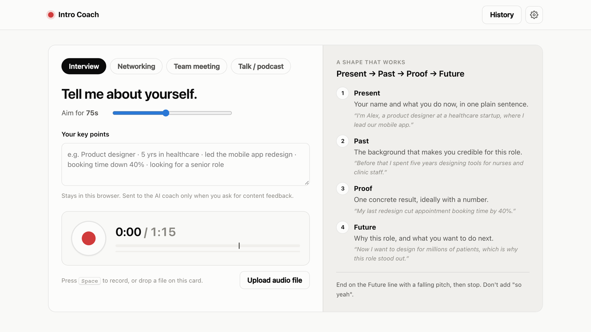
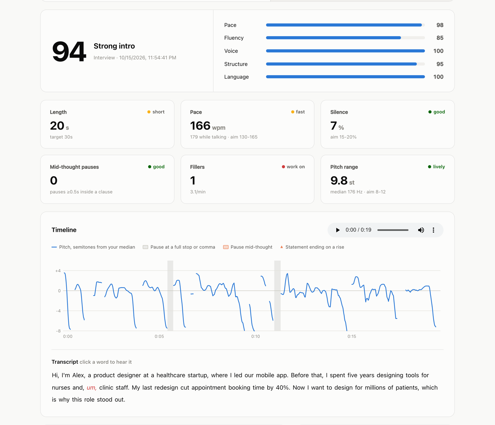
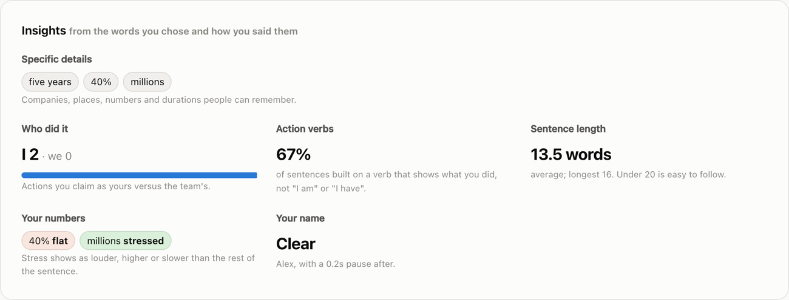

# Intro Coach

Practice your self-introduction and get feedback on how you said it. Record in the browser or upload a file;
Intro Coach transcribes it, measures pace, pauses, fillers and pitch, and checks the structure against a shape
for the situation you picked.

Everything runs locally. The optional AI review sends the transcript and scores, not the audio.





## Situations

| Situation | Shape |
|---|---|
| Interview | Present → Past → Proof → Future |
| Networking | Who → Who you help → Hook |
| Team meeting | Name → Role here → Current focus → How to reach you |
| Talk / podcast | Name → Credibility → Why it matters to them → What's coming |

## What you get

- Scores for pace, fluency, voice, structure and language
- A pitch timeline with pauses marked, split into pauses at full stops and pauses mid-sentence
- A transcript you can click to replay any word
- Tips with timestamps and a drill for each
- Insights: concrete details vs vague words, "I" vs "we", whether you stressed your numbers or rushed your name
- History of past takes



## Install

Needs Python 3.12+, [uv](https://docs.astral.sh/uv/) and ffmpeg.

```sh
uv sync
uv run intro-coach serve    # http://127.0.0.1:8765
```

The speech model (290 MB) downloads to `~/.intro-coach/models` on first start.

Command line:

```sh
uv run intro-coach analyze take.m4a --scenario networking --target 30
uv run intro-coach analyze take.wav --json
```

## AI review

Add an [OpenRouter](https://openrouter.ai/keys) key under Settings (gear icon) to get content feedback and a
rewritten intro from [Nemotron 3.5 Super](https://openrouter.ai/nvidia/nemotron-3.5-super-vl:free) (free tier).
The key is stored in `~/.intro-coach/settings.json`. `OPENROUTER_API_KEY` also works.

To use Claude instead: `uv sync --extra ai`, then set `INTRO_COACH_AI_PROVIDER=claude` and `ANTHROPIC_API_KEY`.

## Configuration

| Variable | Default |
|---|---|
| `INTRO_COACH_HOME` | `~/.intro-coach` |
| `FLUID_MODEL_DIR` | `$INTRO_COACH_HOME/models/fluid-speech-mini-onnx` |
| `INTRO_COACH_AI_PROVIDER` | `openrouter` (or `claude`) |
| `INTRO_COACH_OPENROUTER_MODEL` | `nvidia/nemotron-3.5-super-vl:free` |
| `INTRO_COACH_MODEL` | `claude-opus-5-5` |

## How it works

- Transcription: [Fluid Speech Mini](https://fluidvoice.com/labs/fluid-speech-mini) (ONNX, CPU, English), with
  word timestamps from the decoder
- Pitch, loudness and pauses: Praat via Parselmouth
- Structure checks and insights: spaCy (`en_core_web_sm`)

## Development

```sh
uv run pytest tests
uv run python tests/test_structure.py   # per-check accuracy
```

`tests/corpus.py` and `tests/holdout.py` hold 72 labelled intros for the structure checks.

## Credits

- Fluid Speech Mini by FluidVoice (CC BY 4.0). `asr/fluid.py` follows the model's reference decoder.
- [Parselmouth](https://github.com/YannickJadoul/Parselmouth) (GPL-3.0)
- [spaCy](https://spacy.io) (MIT)

MIT licensed. See [LICENSE](LICENSE).
